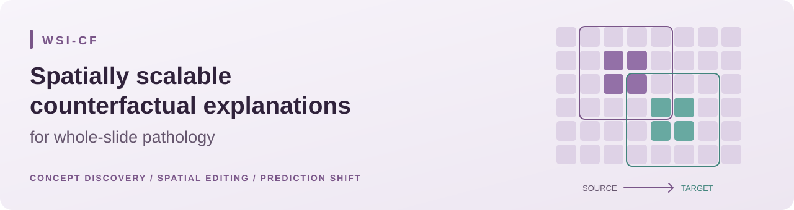
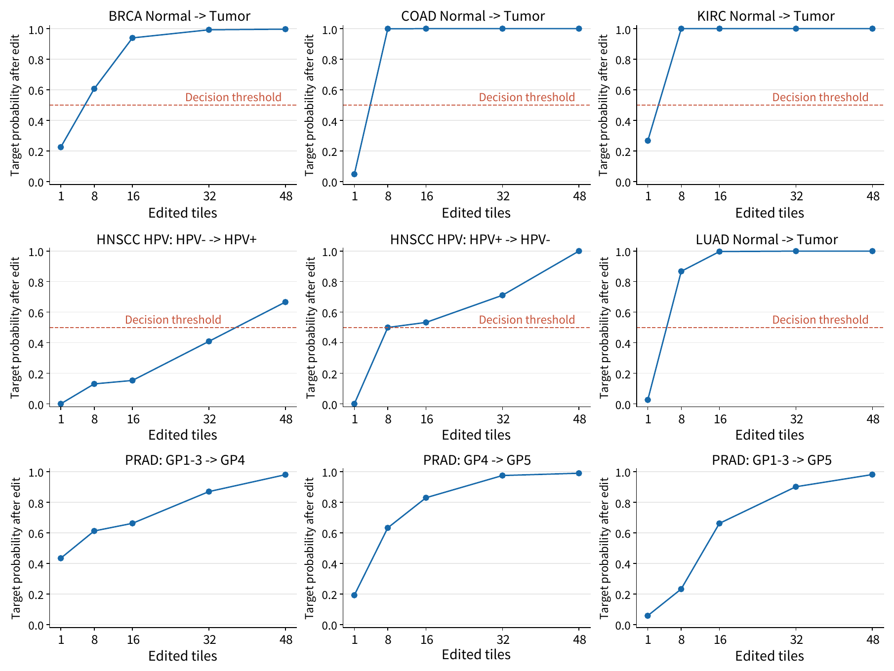

<p align="center">
  
</p>

<p align="center">
  <strong>Discover tissue concepts. Edit selected regions. Trace the prediction shift.</strong>
</p>

<p align="center">
  <a href="#overview">Overview</a> ·
  <a href="#figure-gallery">Figures</a> ·
  <a href="#progressive-editing-in-action">Demo</a> ·
  <a href="#getting-started">Get started</a> ·
  <a href="docs/README.md">Documentation</a>
</p>

---

## Overview

**WSI-CF** is a research framework for spatially scalable counterfactual
explanations in whole-slide pathology. It connects slide-level attention,
sparse autoencoder (SAE) concepts, and PixCell generation to explore how
selected changes in tissue morphology affect a model's prediction.

<a href="paper/figures/conceptual.pdf">
  
</a>

*A counterfactual question: what change to this tissue would shift the model's
prediction from normal to tumor?* [View PDF ↗](paper/figures/conceptual.pdf)

The workflow combines three building blocks:

- **Concept-guided control.** Discover morphological concepts in SAE feature
  space and steer selected tile features toward a target prototype.
- **Spatially progressive generation.** Edit regions through overlapping
  PixCell windows with preservation of previously visited context.
- **Prediction-level evaluation.** Re-encode edited tissue and measure changes
  in downstream predictions alongside visual perturbation.

## Figure gallery

### 01 / Method overview

From whole-slide features to concept-guided interventions: attention identifies
regions, SAE concepts define the steering direction, and progressive generation
produces tissue edits for downstream evaluation.

<a href="paper/figures/main.pdf">
  
</a>

[View method PDF ↗](paper/figures/main.pdf)

### 02 / A shared vocabulary of tissue concepts

The SAE concept bank connects tile features to spatial concept maps and
representative morphology across TCGA cohorts. The figure illustrates concepts
associated with histologic subtype, tumor grade, and molecular status.

<a href="paper/figures/SAE.pdf">
  
</a>

[View concept discovery PDF ↗](paper/figures/SAE.pdf)

### 03 / Local edits, progressive coverage

Selected features are steered within a local edit window. Overlapping windows
extend the intervention across the region while tracking edited cells and
preserving context. The panels compare boundary behavior, visual change, and
the prediction trajectory.

<a href="paper/figures/edit.pdf">
  
</a>

[View progressive editing PDF ↗](paper/figures/edit.pdf)

### 04 / Counterfactuals across tasks and scales

Qualitative examples include normal-to-tumor changes in COAD and KIRC, HPV
status steering in HNSCC, Gleason pattern changes in PRAD, and an edited region
shown in its whole-slide context.

<a href="paper/figures/qual.pdf">
  
</a>

[View qualitative results PDF ↗](paper/figures/qual.pdf)

### 05 / Editing budget and prediction response

The benchmark figure plots target-class probability against the number of
edited tiles across normal-to-tumor, HPV-status, and Gleason-pattern tasks.
Dashed lines mark the model decision threshold.

<a href="paper/figures/bench.pdf">
  
</a>

[View benchmark PDF ↗](paper/figures/bench.pdf) ·
[Browse all six original PDFs](paper/figures/README.md)

## Progressive editing in action

<p align="center">
  
</p>

The HNSCC HPV showcase traverses a selected `2048 × 2048` tissue region.
**Red** marks current edit cells, **grey** marks current context, and **blue**
marks cells already visited by the progressive editor.

[Follow the showcase tutorial →](examples/hnscc_hpv_showcase_smoothed28/README.md)

## Getting started

The figures and animation above can be explored immediately. Running generation
requires the research environment, model access, and prepared region/feature
inputs described in the [setup guide](docs/GETTING_STARTED.md).

```bash
git lfs install
git clone https://github.com/W8Yi/wsi-cf.git
cd wsi-cf
```

Once those inputs and dependencies are configured, run the default HNSCC
showcase with your active Python environment and the bundled legacy SAE:

```bash
PYTHON=python \
DEVICE=cuda:0 \
SAE_CKPT=resources/models/sae/relu_sae_base/relu_final.pt \
SAE_CFG=resources/models/sae/relu_sae_base/run_config.json \
bash examples/hnscc_hpv_showcase_smoothed28/01_run_progressive_edit.sh
```

For the matched baseline and metrics, use
[`run_all.sh`](examples/hnscc_hpv_showcase_smoothed28/run_all.sh) with the same
environment variables. See the [reproduction reference](docs/REPRODUCTION.md)
for original lab commands, policy details, and resource provenance.

## Explore the repository

| Area | Where to start |
| :--- | :--- |
| Method and equations | [Method reference](docs/METHODS.md) |
| Run a region edit | [Progressive editing tutorial](docs/PROGRESSIVE_EDIT_TUTORIAL.md) |
| Find the right command | [Script registry](docs/SCRIPTS.md) |
| Examples and comparisons | [HNSCC workflow](examples/hnscc_hpv/) · [Showcase](examples/hnscc_hpv_showcase_smoothed28/) |
| Model and data resources | [Resource defaults](docs/REPRODUCTION.md#default-resources) · [Task configs](resources/tasks/) |
| Figures and downloads | [Figure collection](paper/figures/README.md) |
| Current research status | [Progress and caveats](docs/PROGRESS.md) |

```text
src/wsi_cf/
├── models/       SAE, MIL, and CLAM models
├── data/         Slides, feature bags, regions, and concept banks
├── steering/     Concept steering and progressive window planning
├── generation/   PixCell generation and preservation
└── eval/         Downstream prediction and region evaluation
```

Large raw slides and precomputed feature stores remain external. Model weights
are tracked with Git LFS. The default task is HNSCC HPV status; task-specific
workflows and resources are documented in the [documentation hub](docs/README.md).
