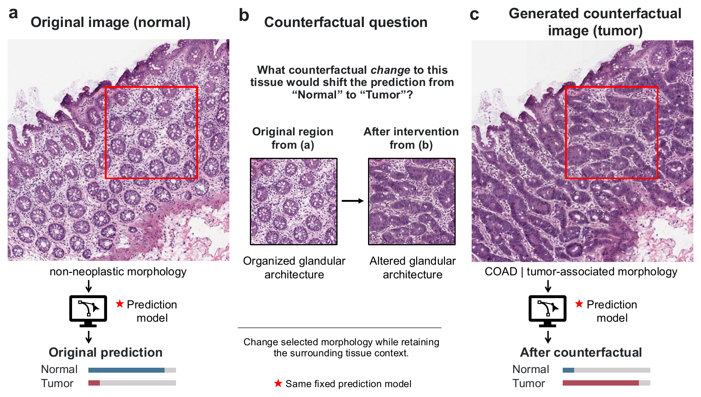
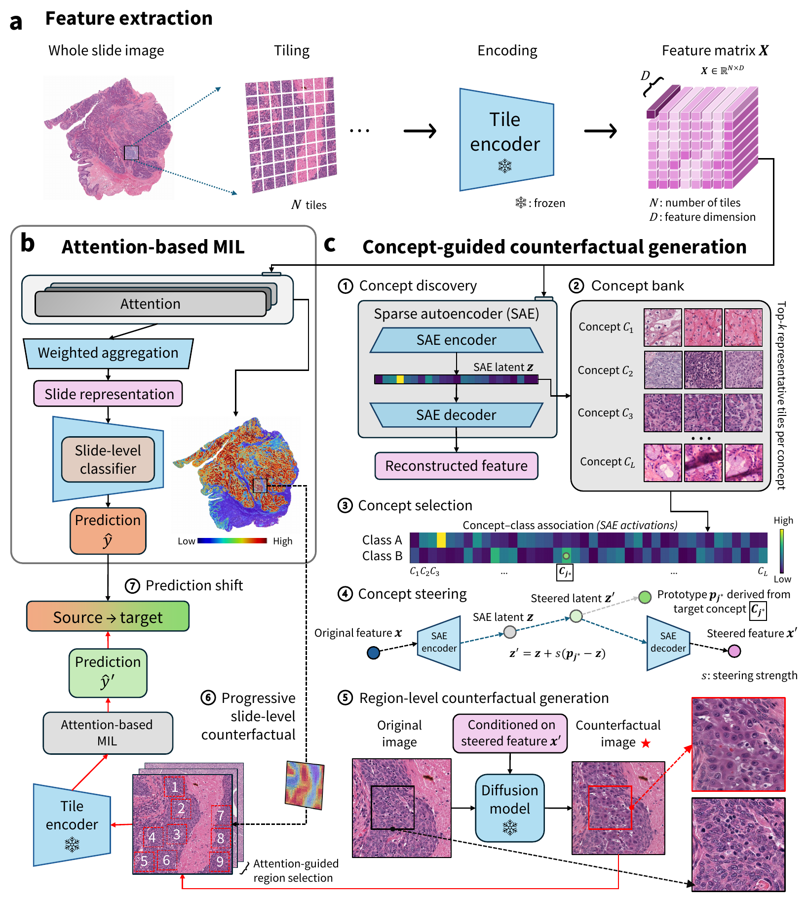
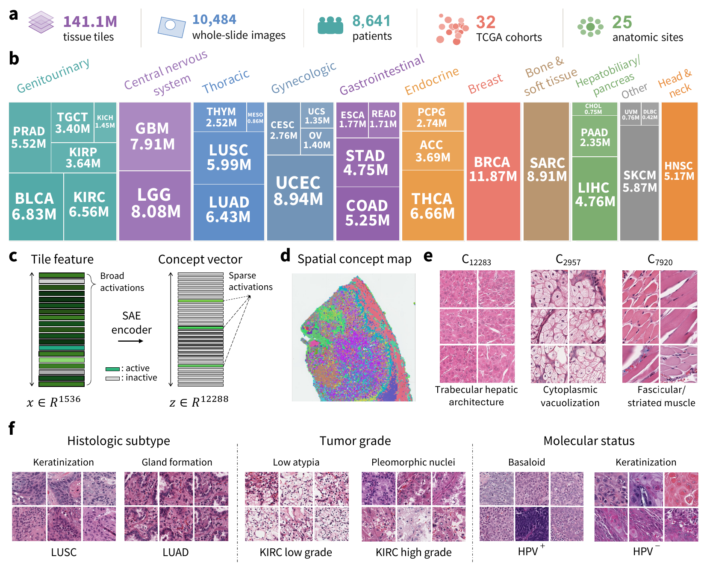
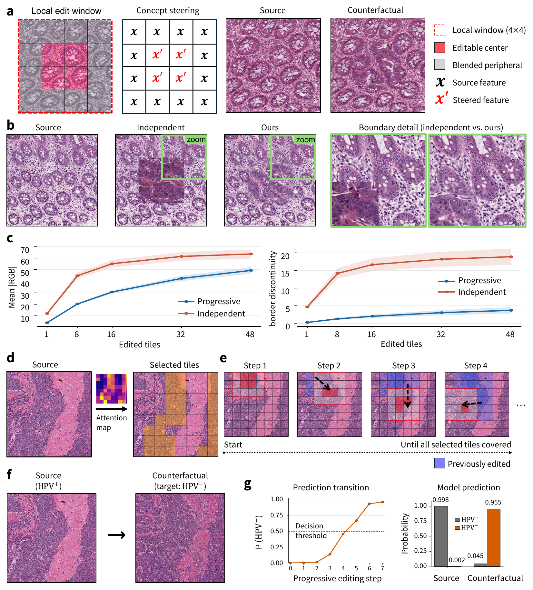
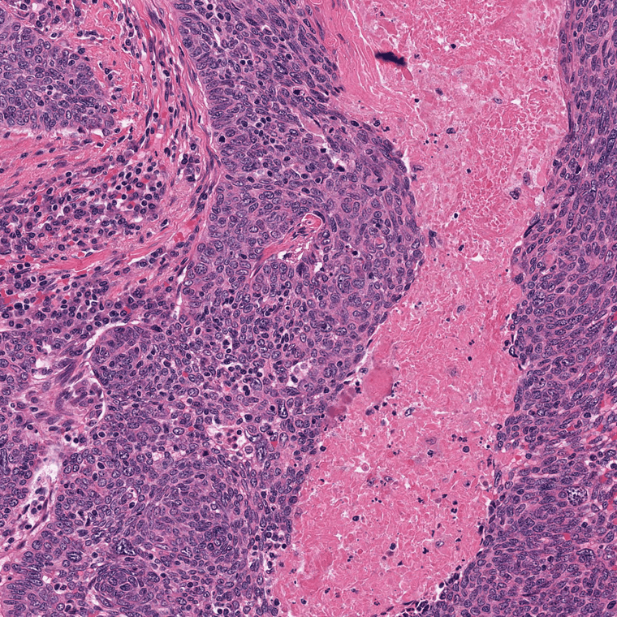
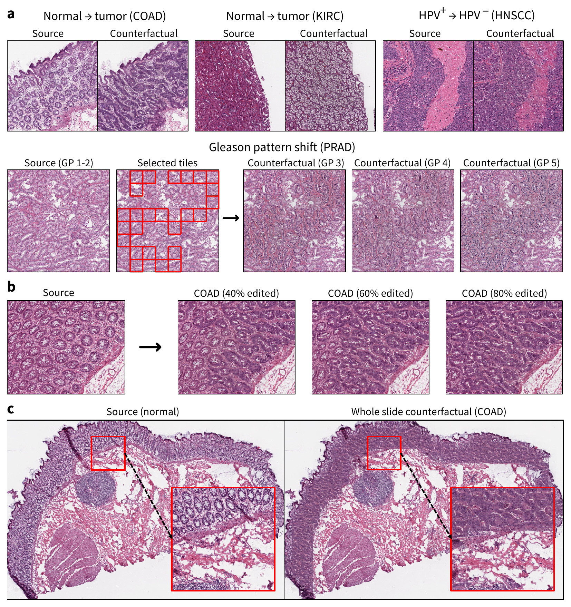

<p align="center">
  
</p>

<p align="center">
  <strong>Discover tissue concepts. Edit selected regions. Trace the prediction shift.</strong>
</p>

<p align="center">
  <a href="#overview">Overview</a> ·
  <a href="#how-it-works">How it works</a> ·
  <a href="#progressive-editing-in-action">Demo</a> ·
  <a href="#getting-started">Get started</a> ·
  <a href="docs/README.md">Documentation</a>
</p>

---

## Overview

**WSI-CF** explores a concrete question: **what change to this tissue would
change the model's prediction?** Starting with a real pathology image, the
pipeline steers selected tissue toward a target morphology, generates the
edited region, and evaluates it with the same prediction model.



Read the example from left to right. The source image is predicted as normal.
Inside the highlighted region, the intervention changes the glandular
appearance toward tumor-associated morphology. Passing the edited image back
through the same model reveals whether that change shifts its prediction.

Two choices guide the intervention: **where to edit** and **what morphology to
move toward**. WSI-CF connects these choices through a shared concept space and
an editor that works across overlapping tissue windows.

## How it works

**Slide → region selection → concept steering → tissue generation → prediction check**

### 01 / Read the slide and choose a region

A whole-slide image is too large to process as one ordinary image. The pipeline
first divides it into tiles and uses a tile encoder to turn each tile into a
numerical description of its tissue. An attention-based multiple instance
learning (MIL) model combines these descriptions into a slide-level prediction.
Its attention map can guide the choice of a region to investigate.



The diagram connects the two sides of the workflow. On the left, the model
summarizes the slide and produces a prediction. On the right, the concept and
generation stages construct a tissue intervention. The loop closes when the
edited tissue is encoded again and passed back to the prediction model.

Once a region is chosen, a grid records the cells to edit. This selection sets
the intervention's location and extent; the next step defines its direction.

### 02 / Choose what morphology to change

A sparse autoencoder (SAE) learns a shared vocabulary of tissue patterns from
tile features. Its concept bank helps identify a direction relevant to the
target task, such as a change in histologic appearance. Representative tiles
for a selected concept provide a **prototype**: a reference feature pattern
toward which the selected source features can be moved.



The collection above gives this vocabulary a broad tissue foundation. Panel
**a** summarizes 141.1 million tiles from 10,484 whole-slide images, covering
8,641 patients, 32 TCGA cohorts, and 25 anatomic sites. Panel **b** shows how the
collection is distributed across cohorts and tissue groups.

Concept steering changes the selected tiles' feature representations before
image generation. The prototype supplies the direction, and steering strength
controls how far the source features move toward it. The generator then turns
those edited features into a tissue image.

### 03 / Generate the edit while preserving context

A local edit needs surrounding tissue to remain visually connected. Within
each `4 × 4` feature window, the editor steers the selected center cells and
uses the surrounding cells as context. PixCell generates the corresponding
tissue, with a preservation map controlling how existing content is retained.



Panel **a** connects the feature edit to its generated appearance. Panel **b**
compares independent editing with the progressive approach; the enlarged
boundary views show where the generated tissue meets its surroundings.

For a larger region, the editor repeats this operation through overlapping
windows. It records which cells have already been visited so that each new
window can incorporate context from the evolving image. This is how local
interventions extend across a larger selected area.

#### Progressive editing in action

Follow the moving window in the animation below. **Red** marks the current
edit cells, **grey** marks current context, and **blue** marks cells already
visited. The example traverses a selected `2048 × 2048` HNSCC tissue region.

<p align="center">
  
</p>

The window moves across the region while its history grows. The final image
is assembled from successive local generations, with each window contributing
to the same tissue canvas. The
[showcase tutorial](examples/hnscc_hpv_showcase_smoothed28/README.md) follows
this sequence in a runnable example.

### 04 / Inspect the tissue and check the prediction

Read each source–counterfactual pair as an intervention: what changed, where
did it change, and how does the result sit within the original tissue?
The examples below span normal-to-tumor changes in COAD and KIRC, HPV-status
steering in HNSCC, and Gleason-pattern changes in PRAD.



Panel **a** shows different target morphologies. Panel **b** varies the fraction
of a region selected for editing, illustrating the spatial extent of the
intervention. Panel **c** places a local edit back into the whole-slide view,
so the changed area can be inspected alongside the surrounding tissue.

The last step returns to the original question. Re-encode the edited tissue,
update the corresponding features, and evaluate them with the same downstream
classifier. Comparing the source and counterfactual predictions shows how the
model responds to the intervention. Reading that response together with the
tissue change connects **the selected concept**, **the edited location**, and
**the model's decision**.

## Getting started

To run this pipeline, prepare the research environment, model access, and
region/feature inputs described in the [setup guide](docs/GETTING_STARTED.md).

```bash
git lfs install
git clone https://github.com/W8Yi/wsi-cf.git
cd wsi-cf
```

Once those inputs and dependencies are configured, run the default HNSCC
showcase with your active Python environment and the bundled legacy SAE:

```bash
PYTHON=python \
DEVICE=cuda:0 \
SAE_CKPT=resources/models/sae/relu_sae_base/relu_final.pt \
SAE_CFG=resources/models/sae/relu_sae_base/run_config.json \
bash examples/hnscc_hpv_showcase_smoothed28/01_run_progressive_edit.sh
```

For the matched baseline and metrics, use
[`run_all.sh`](examples/hnscc_hpv_showcase_smoothed28/run_all.sh) with the same
environment variables. See the [reproduction reference](docs/REPRODUCTION.md)
for original lab commands, policy details, and resource provenance.

## Explore the repository

| Area | Where to start |
| :--- | :--- |
| Method and equations | [Method reference](docs/METHODS.md) |
| Run a region edit | [Progressive editing tutorial](docs/PROGRESSIVE_EDIT_TUTORIAL.md) |
| Find the right command | [Script registry](docs/SCRIPTS.md) |
| Examples and comparisons | [HNSCC workflow](examples/hnscc_hpv/) · [Showcase](examples/hnscc_hpv_showcase_smoothed28/) |
| Model and data resources | [Resource defaults](docs/REPRODUCTION.md#default-resources) · [Task configs](resources/tasks/) |
| Current research status | [Progress and caveats](docs/PROGRESS.md) |

```text
src/wsi_cf/
├── models/       SAE, MIL, and CLAM models
├── data/         Slides, feature bags, regions, and concept banks
├── steering/     Concept steering and progressive window planning
├── generation/   PixCell generation and preservation
└── eval/         Downstream prediction and region evaluation
```

Large raw slides and precomputed feature stores remain external. Model weights
are tracked with Git LFS. The default task is HNSCC HPV status; task-specific
workflows and resources are documented in the [documentation hub](docs/README.md).
